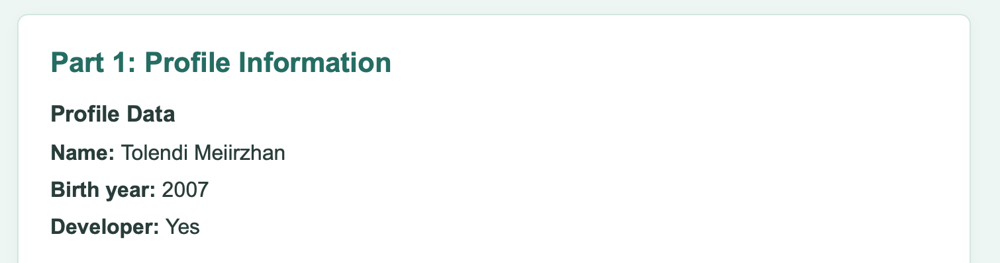
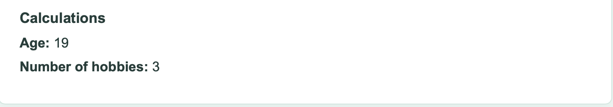
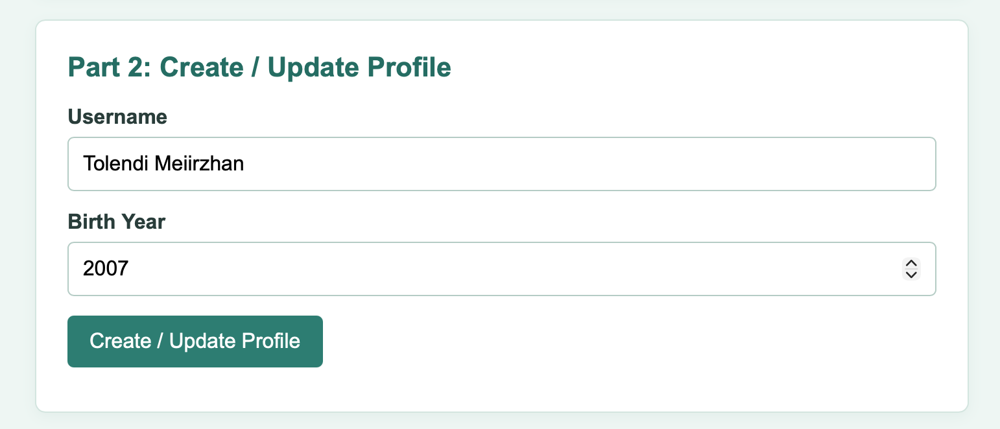
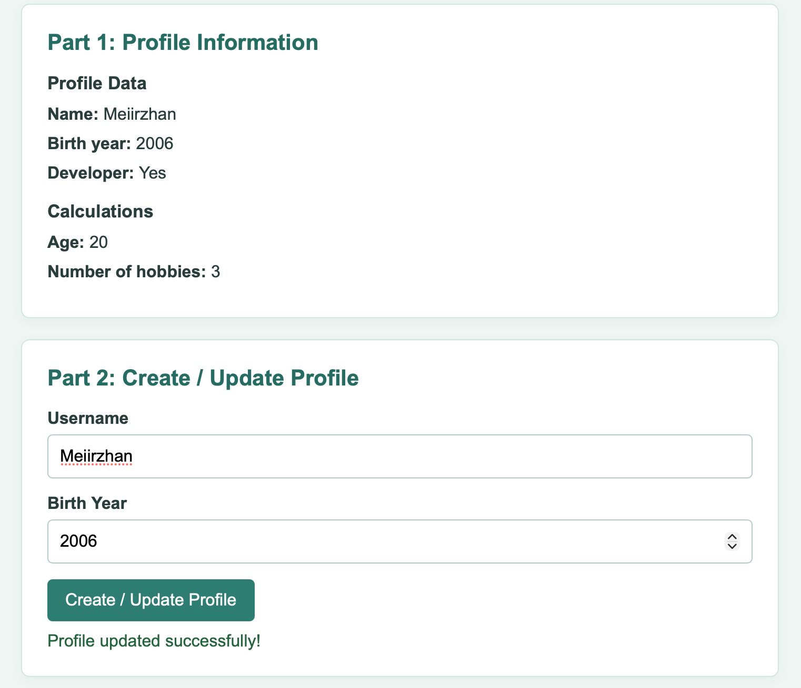
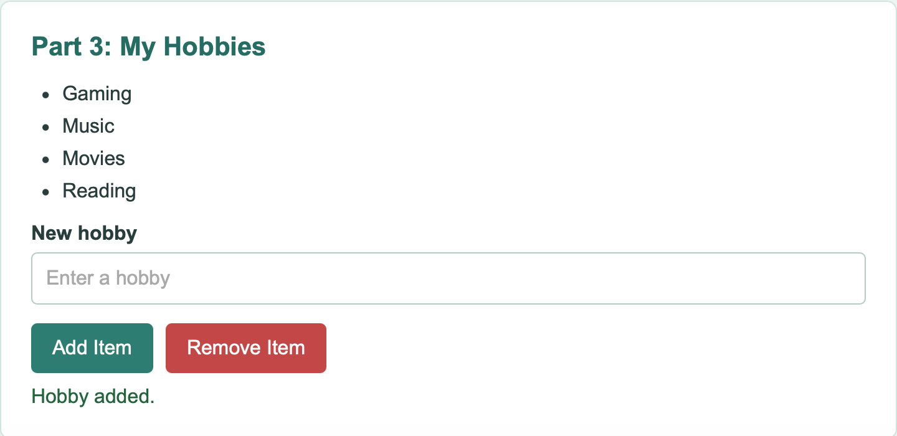
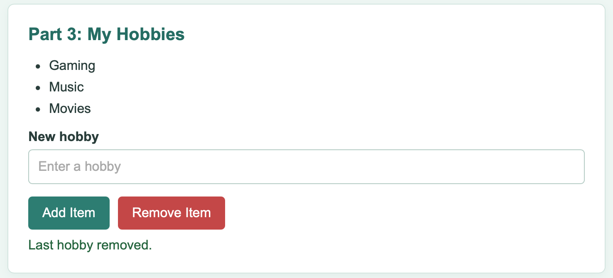

# Assignment 5 - JavaScript Basics

**Name:** Tolendi Meiirzhan  
**Group:** SE-2539

This assignment is about JavaScript objects, basic calculations, forms, events, and DOM manipulation.

## Part 1: Profile Object, Data Types & Arithmetic

### Task 1: The Personal Info Object

I created a `const` object named `userProfile` in `script.js`. It has a name (string), birth year (number), developer status (boolean), and hobbies (array). The information is displayed on the page.

### Task 2: Arithmetic Calculations

I used `new Date().getFullYear()` to get the current year and subtracted the birth year to calculate age. I also used `userProfile.hobbies.length` to count the hobbies. Both values appear on the page and in the console.

## Part 2: Form Input & Event Responses

### Task 3: HTML Form Setup

I added a form with Username and Birth Year inputs and a Create / Update Profile button.

### Task 4: Event Listener

I used `addEventListener("submit", ...)` for the form. When the button is clicked, JavaScript takes the input values and updates `userProfile`. Then the new name, birth year, and age appear on the page.

## Part 3: DOM List Manipulation

### Task 5: Creating & Removing Elements

I made an unordered list of hobbies. The Add Item button creates a new `li` element with `createElement()` and adds it using `appendChild()`. The Remove Item button removes the last list item using `removeChild()`. The number of hobbies changes too.

**Adding an item:**

**Removing the last item:**

## Work Process

First, I made the page structure in `index.html` and added simple styles in `style.css`. Then I created the profile object and calculations in `script.js`. After that, I connected the form and buttons with event listeners. I checked how the profile changes and how items are added to and removed from the list.

